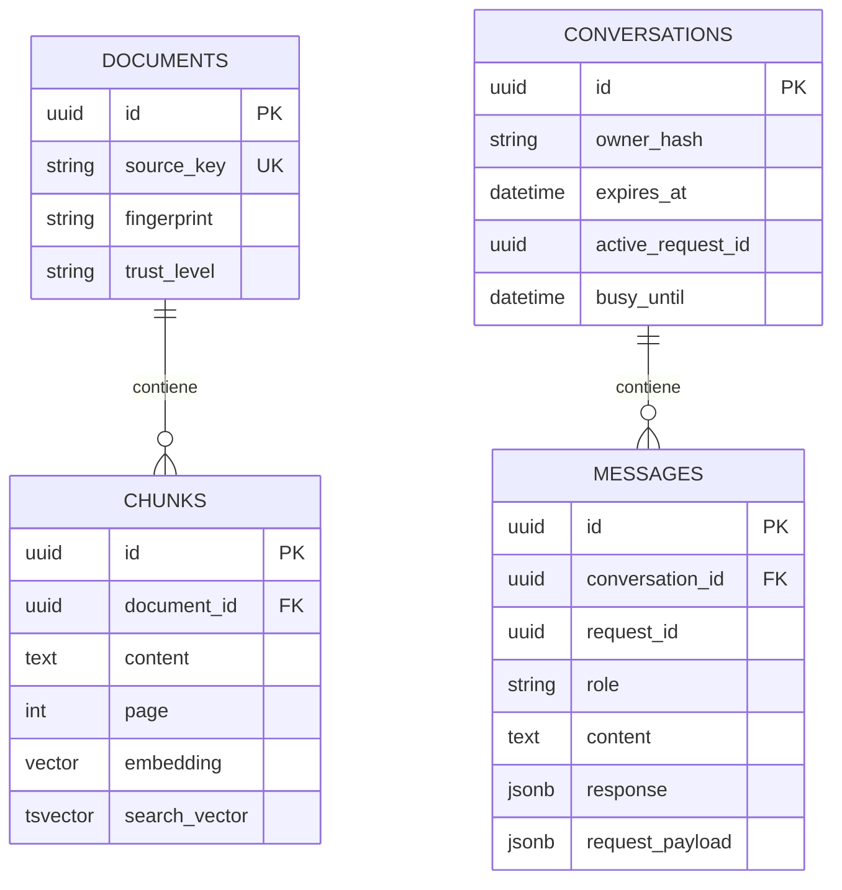

# Guía del código del servidor

Esta guía explica **qué hace cada pieza del backend** y cómo se conectan. Los archivos
Python incluyen docstrings en español: son los textos entre `"""..."""` al inicio de
un módulo, clase o función. Los comentarios explican decisiones puntuales del código.

El servidor tiene dos trabajos distintos: preparar documentos para buscarlos y
responder preguntas usando los fragmentos de esos documentos. PostgreSQL conserva
los documentos indexados y las conversaciones; los modelos generan embeddings,
clasifican preguntas y redactan o verifican respuestas.

## Por dónde empezar

Lee en este orden:

1. [main.py](app/main.py): qué recibe la API y qué devuelve.
2. [schemas.py](app/schemas.py): los datos que puede enviar y recibir el cliente.
3. [service.py](app/service.py): acceso, historial, reintentos y guardado.
4. [graph.py](app/graph.py): cómo se decide y construye una respuesta.
5. [retrieval.py](app/retrieval.py): cómo se encuentran los fragmentos.
6. [ingest.py](app/ingest.py): cómo llegaron esos fragmentos al índice.
7. [models.py](app/models.py) y [config.py](app/config.py): datos persistidos y configuración.

## Conceptos que aparecen en el código

| Término | Qué significa aquí |
| --- | --- |
| RAG | Recuperar evidencia del corpus y entregarla al modelo antes de redactar |
| Corpus | Colección de documentos indexados y habilitados para consulta |
| Chunk | Fragmento de una página; conserva texto y procedencia |
| Embedding | Vector numérico que permite buscar por similitud de significado |
| ORM | Clases Python que representan filas de PostgreSQL, mediante SQLAlchemy |
| Schema | Contrato Pydantic para validar y serializar datos; no es una tabla |
| Nodo | Función de una etapa del flujo de LangGraph |
| Transacción | Operaciones de base que se confirman juntas o se revierten |
| Concesión o lease | Marca temporal que reserva una conversación para una generación |
| Idempotencia | Repetir la misma petición devuelve el resultado guardado sin duplicar el turno |
| ASGI | Interfaz por la que Uvicorn entrega peticiones a FastAPI y sus middleware |
| `async` / `await` | Permite esperar operaciones de red o base sin bloquear todo el proceso |

## Mapa de archivos

| Archivo | Responsabilidad |
| --- | --- |
| [app.py](app.py) | Entrada de desarrollo compatible con `python app.py` |
| [app/__init__.py](app/__init__.py) | Declara el paquete Python `app` |
| [app/main.py](app/main.py) | Construye FastAPI, sus rutas, middleware y manejadores de errores |
| [app/config.py](app/config.py) | Lee y valida configuración del entorno y `.env` |
| [app/database.py](app/database.py) | Motor, sesiones de base y comprobación de la firma del índice |
| [app/models.py](app/models.py) | Clases ORM para documentos, fragmentos y conversaciones |
| [app/schemas.py](app/schemas.py) | Entradas y respuestas HTTP tipadas |
| [app/service.py](app/service.py) | Reglas del ciclo de vida de las conversaciones |
| [app/graph.py](app/graph.py) | Flujo RAG con ramas, verificación y reparación acotada |
| [app/retrieval.py](app/retrieval.py) | Búsqueda semántica, léxica y fusión de resultados |
| [app/providers.py](app/providers.py) | Clientes LangChain para modelos y embeddings |
| [app/prompts.py](app/prompts.py) | Instrucciones enviadas a cada modelo |
| [app/ingest.py](app/ingest.py) | Herramienta local para indexar y actualizar documentos |
| [app/maintenance.py](app/maintenance.py) | Borrado de conversaciones vencidas y contadores antiguos |
| [app/evaluate.py](app/evaluate.py) | Evaluador opcional que utiliza modelos reales |
| [app/errors.py](app/errors.py) | Excepción de negocio con estado HTTP y mensaje público |
| [app/middleware.py](app/middleware.py) | Limita los bytes reales de las peticiones POST |
| [migrations/env.py](migrations/env.py) | Conecta Alembic con SQLAlchemy asíncrono |
| [migrations/versions/001_initial.py](migrations/versions/001_initial.py) | Crea las tablas, índices y restricciones iniciales |
| [alembic.ini](alembic.ini) | Ubicación y configuración básica de las migraciones |
| [migrations/script.py.mako](migrations/script.py.mako) | Plantilla para nuevas revisiones de Alembic |
| [pyproject.toml](pyproject.toml) | Dependencias declaradas y configuración de herramientas |
| [requirements.lock](requirements.lock) | Versiones exactas de las dependencias de ejecución |
| [requirements-dev.lock](requirements-dev.lock) | Dependencias de ejecución y herramientas de pruebas |
| [requirements.txt](requirements.txt) | Referencia al lock de ejecución |
| [Dockerfile](Dockerfile) y [.dockerignore](.dockerignore) | Construcción de la imagen y archivos excluidos de ella |
| [logging.json](logging.json) | Formato y niveles de logs |
| [app/Asperger.pdf](app/Asperger.pdf) | Documento heredado para pruebas; no se indexa al iniciar la API |
| [evals/smoke.jsonl](evals/smoke.jsonl) | Casos sintéticos del evaluador |
| [tests/](tests/) | Comprobaciones de HTTP, grafo, ingesta, proveedor y base |

## Cómo pasa una pregunta por el sistema

```mermaid
sequenceDiagram
    participant C as Cliente
    participant A as main.py
    participant S as service.py
    participant D as PostgreSQL
    participant G as graph.py
    participant R as retrieval.py
    participant M as providers.py
    C->>A: POST /api/chat + cookie + ChatRequest
    A->>S: rate_limit y respond
    S->>D: Autorizar, comprobar reintento y reservar concesión
    D-->>S: Historial reciente; termina la transacción
    S->>G: Ejecutar pregunta con historial y preferencias
    G->>M: Clasificar y aclarar consulta
    opt Pregunta de conocimiento
        G->>R: Recuperar candidatos
        R->>M: Embedding de la consulta
        R->>D: Vectores + texto completo
        D-->>R: Fragmentos con procedencia
        R-->>G: Candidatos fusionados
        G->>M: Seleccionar evidencia, redactar y verificar
    end
    G-->>S: Respuesta final o abstención
    S->>D: Confirmar concesión y guardar ambos mensajes
    S-->>A: ChatResponse
    A-->>C: JSON con respuesta y fuentes
```

Un saludo, una petición fuera del dominio o una urgencia reciben respuestas fijas
después de la clasificación. Una pregunta de conocimiento sin evidencia recibe una
abstención. Los fallos de configuración, base o proveedor se convierten en errores
HTTP; no se presentan como si fueran falta de evidencia documental.

## `main.py`: la entrada HTTP

`app = create_app()` es el objeto que importa Uvicorn. `create_app()` registra las
rutas y permite inyectar un servicio simulado para probar la API. `lifespan()` prepara
el motor de base y los clientes al iniciar y cierra el pool al terminar. Construir
la aplicación **no crea tablas, no indexa el PDF ni prueba la clave con el proveedor**.

`owner_hash()` calcula SHA-256. `get_owner()` valida el formato de la cookie
`autism_insight_session` y devuelve su hash. El servicio comprueba después si ese
propietario puede acceder a la conversación solicitada.

| Ruta | Función | Qué hace |
| --- | --- | --- |
| `GET /api/health/live` | `live()` | Comprueba que la aplicación responde |
| `GET /api/health/ready` | `ready()` | Comprueba firma, modelo configurado y fuentes habilitadas |
| `POST /api/conversations` | `create()` | Exige consentimiento, crea sesión y establece cookie; devuelve 201 |
| `GET /api/conversations/{id}` | `history()` | Devuelve hasta 200 mensajes de una sesión autorizada |
| `DELETE /api/conversations/{id}` | `remove()` | Borra sesión y mensajes; devuelve 204 sin cuerpo |
| `POST /api/chat` | `chat()` | Limita solicitudes y pide una respuesta al servicio |

`boundaries()` comprueba el origen de operaciones que escriben, revisa el tamaño
declarado y añade encabezados para evitar caché y detección de tipos incorrecta.
`BodySizeLimit` cuenta además el cuerpo real, incluyendo peticiones sin
`Content-Length`. El límite de la API es **16 384 bytes**; el límite del campo
`message` es **4000 caracteres**. Son límites distintos.

Los manejadores convierten `ServiceError` en su estado y mensaje, `TimeoutError`
en 504 y errores inesperados en un 503 genérico. Los logs propios omiten contenido
de preguntas y respuestas. En producción, `POST` y `DELETE` necesitan un encabezado
`Origin` permitido. La cookie usa `HttpOnly`, `SameSite=Strict` y `Secure` en producción.

La creación se limita por la IP que ve FastAPI y el chat por el hash de su cookie.
Si un proxy hace que todas las peticiones parezcan venir de la misma IP, el contador
de creación puede compartirse; debe tenerse en cuenta al configurar el ingreso.

## `schemas.py`: los contratos de datos

`ConversationCreate` contiene `consent`. `StrictModel` rechaza campos extra en las
entradas. `ChatRequest` recibe:

| Campo | Significado |
| --- | --- |
| `conversation_id` | UUID de la conversación que debe pertenecer a la cookie |
| `request_id` | UUID del turno; se conserva al reintentar la misma petición |
| `message` | Pregunta no vacía, de hasta 4000 caracteres; se recortan espacios exteriores |
| `audience` | `person`, `family` o `professional`; por defecto `person` |
| `style` | `simple`, `standard` o `detailed`; por defecto `standard` |

Ejemplo de cuerpo JSON con identificadores ilustrativos:

```json
{
  "conversation_id": "b4e7405d-867b-4700-bb52-e36c9f6af10b",
  "request_id": "f8e671ab-d645-4f4c-9fb4-ed220ee5169b",
  "message": "¿Qué dice el documento sobre la comunicación?",
  "audience": "family",
  "style": "simple"
}
```

Para una petición real, primero crea la conversación con `{"consent": true}`, usa
el UUID devuelto y conserva la cookie. Un UUID del ejemplo no concede acceso.

`ChatResponse` devuelve `message_id`, `request_id`, `answer`, `sources` y
`evidence_status`. Cada `Source` contiene el número de cita, UUID del documento y
fragmento, título, página, URL, nivel de confianza y extracto. `MessageView` añade
rol, contenido y fecha al leer el historial; los mensajes del asistente pueden
incluir la respuesta completa guardada.

| Estado de evidencia | Interpretación |
| --- | --- |
| `grounded` | El borrador pasó la validación de citas y la verificación del modelo |
| `insufficient` | Se entregó la respuesta fija de falta de respaldo |
| `not_applicable` | Se usó una ruta de respuesta fija sin recuperación documental |

`grounded` describe el resultado del flujo: no certifica que la fuente sea correcta.
Con la API activa, **http://127.0.0.1:8000/docs** muestra estos contratos y las
descripciones de los endpoints añadidas mediante docstrings.

## `service.py`: acceso, historial y guardado

`ConversationService` recibe base, grafo y configuración. Sus métodos principales:

| Método | Responsabilidad |
| --- | --- |
| `rate_limit(key)` | Contador atómico por minuto en `rate_buckets`; error 429 al superar el límite |
| `create(owner)` | Guarda una conversación y calcula su vencimiento desde la creación |
| `_authorized(..., lock=False)` | Comprueba propietario y vencimiento; opcionalmente bloquea la fila |
| `history(id, owner)` | Entrega mensajes recientes en orden cronológico |
| `remove(id, owner)` | Elimina la conversación con bloqueo de fila; mensajes se borran en cascada |
| `respond(request, owner)` | Coordina reintento, concesión, grafo y guardado completo |
| `_release(id, lease)` | Libera únicamente la concesión de esa ejecución |

`respond()` utiliza **dos transacciones cortas**. La primera autoriza, busca una
respuesta ya guardada para el mismo `request_id`, comprueba la firma de embeddings,
carga el historial y reserva la fila mediante una concesión. Si hay una respuesta
existente, compara también pregunta y preferencias: deben coincidir.

El grafo se ejecuta después, sin mantener una conexión reservada durante las llamadas
externas. La segunda transacción comprueba que la concesión todavía pertenece a
esta ejecución y guarda juntos el mensaje del usuario y la respuesta del asistente.
Si otra petición reemplazó la concesión, o la conversación se borró, no guarda la
respuesta tardía. `finally` intenta liberar la concesión mediante `asyncio.shield`.

**`request_id` y `active_request_id` no son lo mismo.** El primero lo aporta el
cliente para reconocer un turno repetido. El segundo es el UUID interno del lease.
`busy_until` permite a una nueva petición reemplazar una concesión vencida si el
proceso que la tenía murió. Su duración inicial es el timeout del chat más 15 segundos.

`bounded_history()` recorre mensajes desde el más reciente y conserva mensajes
completos que caben en el presupuesto de caracteres. Se detiene ante el primero
que no cabe y devuelve el tramo en orden cronológico. Antes de aplicarlo, `respond()`
limita la consulta a `history_turns × 2` mensajes. El valor inicial de ocho turnos
equivale a un máximo de 16 mensajes, no a ocho preguntas más todo el historial.

## `graph.py` y `prompts.py`: construir una respuesta

`build_graph()` registra nodos y conexiones condicionales. Los nodos devuelven
diccionarios parciales que LangGraph incorpora al `GraphState`. El grafo inicia
estado nuevo por pregunta y no guarda conversaciones; el servicio ya le entrega
el historial autorizado.

| Nodo | Entrada utilizada | Resultado |
| --- | --- | --- |
| `plan` | Pregunta e historial | `Plan`: ruta y consulta autónoma, de hasta 1000 caracteres |
| `retrieve` | Consulta aclarada | Candidatos devueltos por `HybridRetriever` |
| `select` | Pregunta, consulta y candidatos | Evidencia suficiente y ordenada, o lista vacía |
| `generate` | Evidencia, consulta, preferencias y motivo de corrección | `Draft`: respuesta, citas y señal de insuficiencia |
| `verify` | Borrador y evidencia | Validación local y dictamen `Verification` del modelo |
| `finalize` | Borrador aceptado | Respuesta y únicamente las fuentes citadas |
| `abstain` | Cualquier ruta sin respaldo suficiente | Mensaje fijo de insuficiencia, sin fuentes |
| `direct` | Ruta no documental | Respuesta fija para saludo, fuera del dominio o urgencia |

`Selection.ids` y `Draft.citations` usan **números locales empezando en 1**.
`evidence_payload()` los asigna según la lista que está recibiendo el modelo.
Después de seleccionar fragmentos, se numeran de nuevo para generar y verificar;
los UUID del documento y fragmento se conservan aparte para la procedencia.

`citation_error()` verifica que los números existan y coincidan con los declarados,
que se use `[n]` individual y que no haya enlaces generados. También rechaza texto
vacío o de más de 6000 caracteres. El prompt pide unos 1800 caracteres: esa es una
instrucción al modelo; 6000 es el control aplicado en código.

Una respuesta normal puede tener cuatro llamadas de modelo: planificación,
selección, generación y verificación. Se permite **un segundo borrador**, lo que
puede añadir dos llamadas. Si ese borrador falla, se responde con `ABSTAIN`. Si un
borrador declara `insufficient_evidence=True`, se abstiene directamente.

Los prompts son instrucciones, no funciones ejecutables:

| Constante | Intención |
| --- | --- |
| `BOUNDARY` | Reglas comunes de lenguaje, dominio y tratamiento de contenido no confiable |
| `PLAN` | Clasificar y aclarar preguntas de seguimiento |
| `SELECT` | Elegir y ordenar evidencia útil; evaluar su suficiencia |
| `ANSWER` | Redactar según audiencia y estilo con citas individuales |
| `VERIFY` | Comprobar soporte factual y límites de la respuesta |

Cambiar estos textos cambia instrucciones del modelo y merece evaluación con los
casos del proyecto. Verificar con otro llamado de modelo reduce errores, pero no
constituye una demostración de veracidad ni garantiza resistencia a inyecciones.

## `retrieval.py` y `providers.py`: buscar y llamar a los modelos

`HybridRetriever.search(query)` genera el embedding de la consulta y ejecuta dos
búsquedas filtradas por fuentes permitidas. Una ordena por distancia coseno en
pgvector; la otra usa `websearch_to_tsquery` y `ts_rank_cd` para texto completo en
español. Cada consulta trae como máximo `retrieval_candidates` resultados.

`reciprocal_rank_fusion()` combina **posiciones** usando `1 / (60 + posición)` y
suma el aporte de ambas listas para cada fragmento. Un fragmento que aparece en
las dos listas puede subir en la clasificación. Elimina IDs repetidos dentro de
una lista y textos exactamente iguales al construir la salida. No calcula una
probabilidad de certeza; la selección y suficiencia las decide el siguiente nodo.

`Evidence` conserva texto, título, página, URL y confianza. La API permite fuentes
`demo` solo en entornos no productivos cuando están habilitadas. El corpus es común
para todos los usuarios; esta versión no aplica permisos documentales por tenant.

En `providers.py`, `create_embeddings()` prepara el proveedor con 1536 dimensiones,
timeout de 25 segundos y un reintento. `StructuredModels` prepara clientes para
`planner` y `answer`, con timeout de 30 segundos, un reintento y límite de 4096
tokens de finalización por llamada. Ese límite no equivale a caracteres visibles.

`StructuredModels.call()` envía instrucciones como mensaje de sistema y los datos
como JSON en un mensaje de usuario. Exige un esquema estructurado con `strict=True`
y devuelve el objeto Pydantic interpretado. Si el resultado falta o no puede
interpretarse, lanza `RuntimeError`; los errores de red se propagan. El cliente
HTTP puede sustituirse por un transporte simulado en pruebas.

## `models.py` y las migraciones: qué se guarda



El diagrama muestra relaciones y campos principales; el código incluye también
títulos, URLs, posiciones y fechas. Hay otras dos tablas sin relaciones en este diagrama:

- `corpus_config`: firma del modelo y dimensión empleados al crear el índice.
- `rate_buckets`: clave de contador, minuto y número de solicitudes; usa SQL directo.

`Document.source_key` identifica una fuente estable. Su `fingerprint` detecta
cambios. `Chunk.embedding` sirve para búsqueda semántica y `search_vector` es
una columna calculada por PostgreSQL para palabras clave. Son representaciones
distintas del mismo contenido.

`Message.response` guarda el JSON completo de la respuesta del asistente, incluidas
sus citas. `request_payload` guarda pregunta y preferencias para comparar reintentos.
Los UUID y el hash de cookie son identificadores; el texto de mensajes y fragmentos
sí se guarda legible en la base. El hash de cookie no cifra las conversaciones.

La revisión `001_initial.py` crea la extensión, tablas, claves foráneas, restricciones
y los índices HNSW para vectores y GIN para texto completo. También fija la firma
del corpus. `upgrade()` aplica esos cambios; `downgrade()` elimina las tablas y sus
datos. `models.py` por sí solo no aplica cambios a una base existente.

## `ingest.py`: preparar los documentos

| Función | Qué hace |
| --- | --- |
| `load_pages(path)` | Extrae texto de PDF o lee TXT/Markdown y conserva página |
| `split_pages(pages)` | Divide por tokens sin perder metadatos |
| `document_fingerprint(...)` | Calcula huella de contenido y configuración |
| `ingest(...)` | Comprueba cambios, genera vectores y actualiza la fuente |
| `main()` | Lee argumentos, prepara dependencias y ejecuta la herramienta |

Los límites iniciales son 20 MiB por archivo, 500 páginas PDF y 2000 fragmentos.
Cada fragmento tiene un máximo de 600 tokens con solapamiento de 90. Los PDF
cifrados se rechazan y no se realiza OCR. TXT y Markdown deben ser UTF-8 y usan
`page=None`; las páginas de PDF se cuentan desde 1.

La huella incluye contenido, título, URL, confianza, modelo, dimensión, tamaño de
fragmento y solapamiento. Una fuente sin cambios devuelve `unchanged` y evita nuevos
embeddings. Una fuente modificada obtiene primero todos los vectores; después una
transacción bloquea la `source_key`, comprueba otra vez la huella y reemplaza los
fragmentos. Esto conserva el índice anterior si el proveedor falla antes del reemplazo.

Ejemplo desde `Server/`, con migraciones y configuración ya preparadas:

```bash
python -m app.ingest app/Asperger.pdf \
  --source-key asperger-demo \
  --title "Asperger — documento de prueba" \
  --trust-level demo
```

`--source-url` es procedencia mostrable, no una URL que el programa descargue.
`reviewed` es una clasificación asignada por el operador, no una revisión automática.
La herramienta local realiza llamadas facturables al generar embeddings.

## `config.py`: qué parámetros cambiar

Los valores siguientes son los **valores por defecto del código**; `.env` y el
entorno pueden reemplazarlos. Por ejemplo, `.env.example` habilita fuentes demo
para desarrollo aunque `Settings` las deshabilita por defecto.

| Variable | Valor inicial | Efecto |
| --- | --- | --- |
| `ENVIRONMENT` | `development` | Controla cookie segura, origen obligatorio y exclusión de demo |
| `DATABASE_URL` | URL local de PostgreSQL | Base usada por API y herramientas |
| `OPENAI_API_KEY` | Vacía | Permite construir los clientes de modelos |
| `CHAT_MODEL` | `gpt-5.4-mini` | Modelo que redacta borradores |
| `PLANNER_MODEL` | `gpt-5.4-mini` | Modelo que clasifica, selecciona y verifica |
| `EMBEDDING_MODEL` | `text-embedding-3-large` | Espacio vectorial de documentos y consultas |
| `CORS_ORIGINS` | Orígenes locales del cliente | Lista JSON de orígenes permitidos |
| `ALLOW_DEMO_SOURCES` | `false` | Permite demo solo fuera de producción |
| `CHAT_TIMEOUT_SECONDS` | `90` | Tiempo máximo de la ejecución del grafo |
| `SESSION_TTL_DAYS` | `30` | Vencimiento fijo desde creación de conversación |
| `RATE_LIMIT_PER_MINUTE` | `12` | Solicitudes por clave y ventana de un minuto |
| `RETRIEVAL_CANDIDATES` | `16` | Máximo por búsqueda y después de RRF |
| `RETRIEVAL_TOP_K` | `6` | Máximo de fragmentos que se entregan al generador |
| `HISTORY_TURNS` | `8` | Máximo de pares de mensajes consultados para contexto |
| `MAX_HISTORY_CHARS` | `18000` | Presupuesto del historial completo enviado a planificación |

`EMBEDDING_DIMENSIONS=1536` es una constante compartida con los modelos de datos.
Cambiar el modelo de embeddings exige reindexar en una base compatible; conservar
la dimensión no hace compatibles dos espacios vectoriales distintos.

`get_settings()` reutiliza la configuración por proceso. Reinicia la API después
de modificar `.env`. `SecretStr` evita mostrar la clave en representaciones normales
de ese campo; no sustituye protección de archivos ni un gestor de secretos.

## Mantenimiento, evaluación y errores

`python -m app.maintenance` elimina conversaciones vencidas y contadores de más de
120 minutos. El vencimiento ya impide acceder al historial, pero el borrado físico
necesita esta tarea. No hay un programador interno: debe ejecutarla el operador.

`python -m app.evaluate evals/smoke.jsonl` procesa de 1 a 100 casos con modelos reales.
Cada línea contiene `id`, `question`, `expected_status`, `expected_source_keys` e
historial opcional. Valida fuentes esperadas y mide estado, recuperación de fuentes,
cantidad de citas y latencias mediana/p95. No guarda conversaciones. Sale con código
0 si todos los estados pasan y 1 si alguno no pasa; un fallo operativo interrumpe
la ejecución. El reporte no demuestra exactitud factual o adecuación clínica.

| Estado HTTP | Situación habitual en el servidor |
| --- | --- |
| `400` | No se aceptó el procesamiento al crear la conversación |
| `401` | Cookie ausente o con formato inválido |
| `403` | Origen no permitido, o ausente en producción |
| `404` | Conversación inexistente, ajena o vencida |
| `409` | Generación en curso, concesión reemplazada o reintento con contenido diferente |
| `413` | Cuerpo de la petición demasiado grande |
| `422` | Datos que no cumplen el contrato de Pydantic |
| `429` | Límite de solicitudes alcanzado |
| `503` | Servicio sin configuración necesaria o fallo operativo |
| `504` | Tiempo de ejecución agotado |

## Pruebas y dónde hacer cambios

| Archivo de pruebas | Qué comprueba |
| --- | --- |
| [test_api.py](tests/test_api.py) | Consentimiento, cookies, acceso, origen y validación HTTP |
| [test_graph.py](tests/test_graph.py) | Rutas, selección, citas, seguimiento y reparación acotada |
| [test_ingest.py](tests/test_ingest.py) | Lectura, división, huellas e historial acotado |
| [test_providers.py](tests/test_providers.py) | Contrato LangChain/SDK con HTTP simulado y logs privados |
| [test_database.py](tests/test_database.py) | PostgreSQL real: índices, reintentos, concurrencia, ingesta y filtros |

Desde la raíz, con el entorno virtual activo:

```bash
ruff check Server
ruff format --check Server
pytest Server/tests -q
```

Las pruebas de base requieren una base aislada y migrada indicada mediante
`TEST_DATABASE_URL`, con nombre terminado en `_test`; vacían sus tablas al empezar
cada caso. Sin esa variable se omiten. Las pruebas normales simulan los modelos.

| Quiero cambiar… | Lugar principal |
| --- | --- |
| El tono y el formato de las respuestas | `prompts.py` y evaluación de ejemplos |
| Una regla del flujo o una ruta | `graph.py` y `test_graph.py` |
| La búsqueda o su orden | `retrieval.py` y pruebas con fuentes esperadas |
| Tamaño de fragmentos o extracción | `ingest.py`; volver a ingerir con la misma `source_key` |
| El modelo de chat | Entorno o `.env`, seguido de evaluación |
| El modelo de embeddings | Configuración y reindexación compatible |
| Sesiones, retención o reintentos | `service.py`, `config.py` y `maintenance.py` |
| Los campos de una ruta HTTP | `schemas.py` y el endpoint en `main.py` |
| Las tablas | `models.py` y una nueva revisión de Alembic |
| Límites del cuerpo u origen | `middleware.py`, `main.py` y configuración del ingreso |

Para instalar y arrancar consulta [el README principal](../README.md). Las decisiones
de arquitectura y los límites antes de producción están en
[docs/architecture.md](../docs/architecture.md). El informe de verificaciones del
proyecto está en [docs/validation.md](../docs/validation.md).
