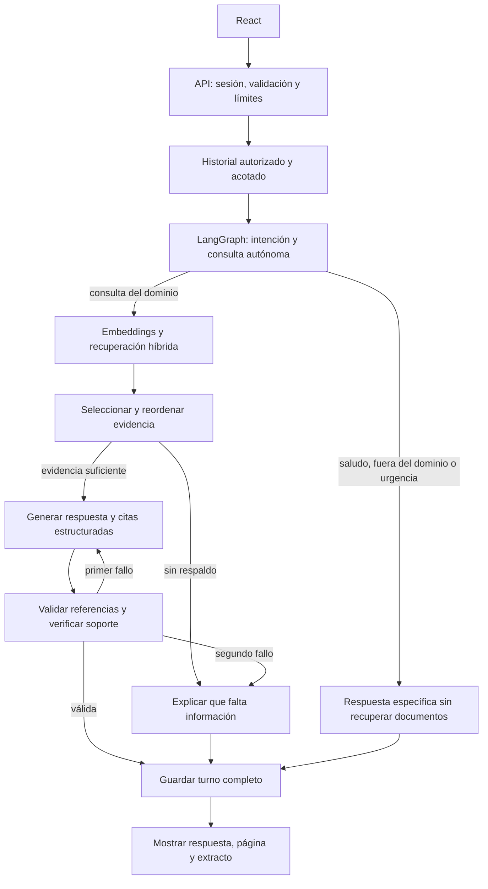

# Arquitectura de Autism Insight

La implementación reemplaza el prototipo que enviaba los primeros 1000 caracteres
de un PDF por un flujo RAG con documentos indexados, recuperación híbrida y citas.
Es un monolito modular con API asíncrona y una base de datos transaccional; sus
límites permiten separar ingesta, recuperación y generación cuando la carga lo requiera.

## Componentes y decisiones

| Componente | Implementación | Motivo |
| --- | --- | --- |
| Interfaz | React, Vite, Markdown sin HTML, voz del navegador | Mantener el cliente existente y mejorar fuentes, consentimiento y accesibilidad |
| API | FastAPI, Pydantic | Contratos tipados, validación y E/S asíncrona |
| Orquestación | LangGraph `StateGraph` | Rutas explícitas, reparación acotada y pruebas por escenario |
| Integración de modelos | LangChain y `langchain-openai` | Salidas estructuradas, embeddings y una frontera sustituible del proveedor |
| Modelo inicial | `gpt-5.4-mini`, configurable | Punto de partida para medir calidad, coste y latencia; no se declara ganador sin evaluarlo |
| Embeddings | `text-embedding-3-large`, 1536 dimensiones | Modelo multilingüe; dimensión compatible con el índice HNSW de `vector` |
| Base vectorial | PostgreSQL + pgvector | Vectores, metadatos y sesiones en un mismo sistema, con transacciones y borrado en cascada |
| Recuperación | Coseno HNSW + búsqueda de texto completo en español + RRF | Combinar coincidencia semántica y términos exactos sin mezclar escalas de puntuación |
| Selección de evidencia | Modelo con esquema estructurado | Reordenar fragmentos por utilidad y abstenerse cuando solo coinciden palabras |
| Persistencia | SQLAlchemy, Psycopg, Alembic | Migraciones versionadas y límites claros del acceso a datos |
| Operación local | Docker Compose y Nginx | API y cliente con `/api` en el mismo origen |

La documentación oficial describe las [salidas estructuradas de ChatOpenAI](https://docs.langchain.com/oss/python/integrations/chat/openai)
y las [rutas condicionales de LangGraph](https://docs.langchain.com/oss/python/langgraph/graph-api).
OpenAI documenta el [modelo inicial](https://developers.openai.com/api/docs/models/gpt-5.4-mini)
y la [reducción de dimensiones de embeddings](https://developers.openai.com/api/docs/guides/embeddings).
La dimensión de 1536 es una decisión de este proyecto: el índice HNSW del tipo `vector`
tiene un límite de 2000 dimensiones según [pgvector](https://github.com/pgvector/pgvector).

## Flujo de una pregunta

Los documentos y el historial entran al modelo como datos no confiables. El modelo
no dispone de herramientas de ejecución, navegación ni acceso a secretos. La
validación comprueba referencias numéricas y rechaza enlaces generados; después
un modelo revisa si las afirmaciones están respaldadas por los fragmentos citados.
Se permite una reparación y se abstiene si vuelve a fallar.

Este control reduce errores; no demuestra veracidad ni reemplaza una evaluación
independiente. Una fuente incorrecta puede producir una respuesta correctamente
citada que también sea incorrecta. El PDF heredado contiene afirmaciones categóricas
y carece de una referencia bibliográfica visible: se conserva como material `demo`.
La calidad clínica y editorial del corpus requiere revisión humana.

Una respuesta normal puede usar cuatro llamadas al modelo, una petición de
embeddings y hasta dos llamadas adicionales para reparar. Las rutas simples usan
una llamada de clasificación. Hay límites de candidatos, contexto, salida, reintentos
y tiempo total. No se muestran tokens de una respuesta antes de verificarla;
la versión actual entrega JSON completo, sin streaming de tokens.

## Ingesta y actualización

1. Un administrador aporta un PDF con texto, TXT o Markdown mediante CLI.
2. Se validan formato y presupuesto: 20 MiB, 500 páginas y 2000 fragmentos máximos.
3. LangChain divide cada página en fragmentos de 600 tokens con solapamiento de 90.
4. La huella incluye contenido, modelo, configuración de división y metadatos.
5. Una fuente sin cambios no vuelve a generar embeddings. Los lotes contienen como máximo 32 fragmentos.
6. Los embeddings se calculan antes de modificar el índice activo.
7. Una transacción reemplaza los fragmentos de la misma `source_key`.

Cada fragmento conserva documento y página. Los PDF escaneados sin texto requieren
OCR antes de la ingesta. No hay endpoint público de subida de documentos.

El índice fija la firma de embeddings en `corpus_config`. Cambiar el modelo aunque
mantenga la dimensión no hace compatibles los vectores anteriores. Para cambiarlo,
crea e indexa una nueva base de datos, ejecuta evaluaciones y después cambia la API
a ella. No mezcles modelos en el mismo índice.

## Sesiones, concurrencia y privacidad

Una cookie aleatoria de 256 bits identifica al navegador; PostgreSQL conserva su
hash. La cookie es `HttpOnly`, `SameSite=Strict` y `Secure` en producción. Conocer
el UUID de otra conversación no concede acceso. El cliente guarda el UUID seleccionado
y hasta 20 UUID recientes de esta pestaña en `sessionStorage`; el servidor conserva
el historial. Los títulos visibles se calculan en memoria. Las preferencias de
lenguaje, tamaño de texto y contraste se guardan en `localStorage`, sin mensajes.

La API requiere consentimiento al crear una conversación. Envía a OpenAI las
preguntas, el historial necesario y los fragmentos recuperados. No envía el corpus
completo en cada turno. La lectura en voz alta utiliza el navegador y sus voces;
su comportamiento depende del navegador y del sistema operativo.

Cada turno adquiere una concesión temporal en la fila de la conversación usando
una transacción corta. Libera la conexión durante las llamadas al modelo. Otros
workers reciben `409` mientras la concesión esté vigente. Si un proceso muere, la
concesión vence; una respuesta antigua no puede guardar datos después de que otro
turno haya adquirido una nueva concesión. Eliminar la conversación durante una
generación impide guardar esa respuesta tardía.

`request_id` garantiza que repetir un turno ya guardado devuelve la misma respuesta;
reutilizarlo con otro contenido devuelve `409`. Usuario y asistente se guardan
juntos, después de generar y verificar. Un fallo no deja mensajes parciales.

LangGraph utiliza estado nuevo por petición. La memoria duradera proviene de
mensajes autorizados de PostgreSQL, con un máximo inicial de ocho turnos y 18 000
caracteres. No se duplican preguntas y documentos en un segundo historial de
checkpoints. Si se añaden procesos largos que necesiten reanudación, se podrá
integrar un checkpointer persistente con una política explícita de borrado.

Las conversaciones vencen por defecto en 30 días. La expiración impide el acceso,
pero el borrado físico necesita ejecutar `app.maintenance` diariamente. Las copias
de seguridad necesitan su propia política de retención; borrar una conversación
activa no borra automáticamente copias anteriores ni datos retenidos por el proveedor.

Los logs de aplicación contienen duración, estado y consumo de tokens, sin textos
de preguntas, respuestas ni fragmentos. LangSmith queda desactivado por defecto:
habilitarlo puede enviar trazas con contenido a otro servicio y requiere una decisión
explícita sobre ese tratamiento. No se ha configurado anonimización automática de PII.

El acceso actual es por navegador y cookie, sin cuentas OIDC, equipos ni tenant
clínicos. Los documentos forman un corpus común; no uses esta configuración para
documentos privados de pacientes u organizaciones con permisos diferentes.

## Verificación y calidad

Las pruebas locales cubren el grafo con modelos simulados, el contrato real del SDK
con transporte HTTP simulado, y PostgreSQL con pgvector real usando embeddings
deterministas. Playwright prueba el cliente en un navegador con una API simulada.
CI reproduce las verificaciones con una base de datos de prueba aislada.

El evaluador `app.evaluate` ejecuta casos sintéticos con los modelos reales y
registra aciertos de estado, recuperación de fuentes, cantidad de citas y latencias.
Es una prueba de funcionamiento, no una certificación de exactitud. Antes de cambiar
modelo, fragmentación o recuperación, construye un conjunto representativo revisado
por personas autistas, familias y profesionales, con fuentes y respuestas esperadas.
Mide recuperación, relevancia, respaldo factual, abstenciones incorrectas, comprensión,
coste y latencia. Amplía también los casos de inyección de instrucciones y preguntas
fuera del corpus; las instrucciones del prompt por sí solas no garantizan resistencia.

## Paso a producción

La configuración Docker es para desarrollo local. Para ofrecer el servicio real
se necesita HTTPS, credenciales distintas, PostgreSQL administrado o respaldado,
retención programada, un corpus revisado y evaluación con usuarios.

Configura `ENVIRONMENT=production`, `ALLOW_DEMO_SOURCES=false` y los orígenes HTTPS
exactos en `CORS_ORIGINS`. El navegador y `/api` deben compartir origen.
El entorno de producción excluye siempre las fuentes `demo`, incluso si se activa
esa opción por accidente. La ingesta y las migraciones deberían usar un usuario de
base de datos distinto del de la API.
Activa presupuestos de gasto del proveedor y límites de tráfico en el ingreso:
el límite por cookie no sustituye cuotas por cuenta ni protección contra abuso distribuido.

No se han añadido Redis, una cola de trabajos ni varios agentes autónomos porque
la implementación actual no los necesita. Si la ingesta pasa a ser una función web,
separarla en un worker con cola evita bloquear peticiones; si aparecen cuentas y
documentos privados, añade autorización por tenant antes de recuperar fragmentos.
La integración de nuevos componentes deberá justificarse con métricas de carga y calidad.
